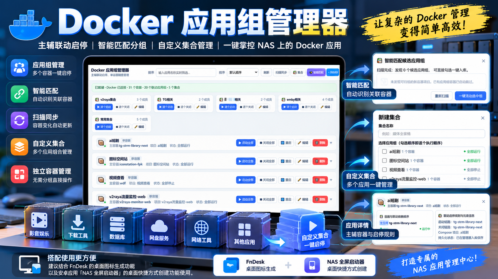
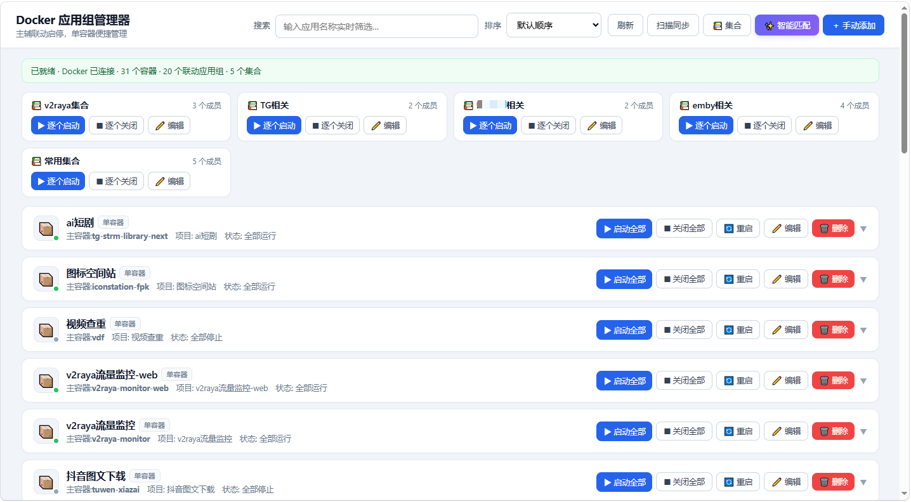
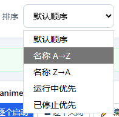
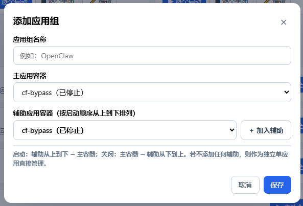
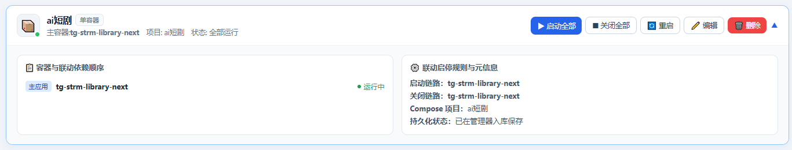
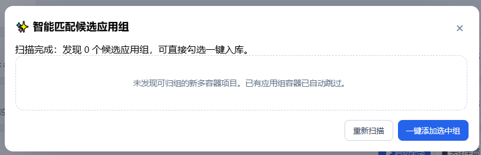
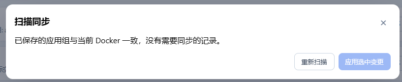
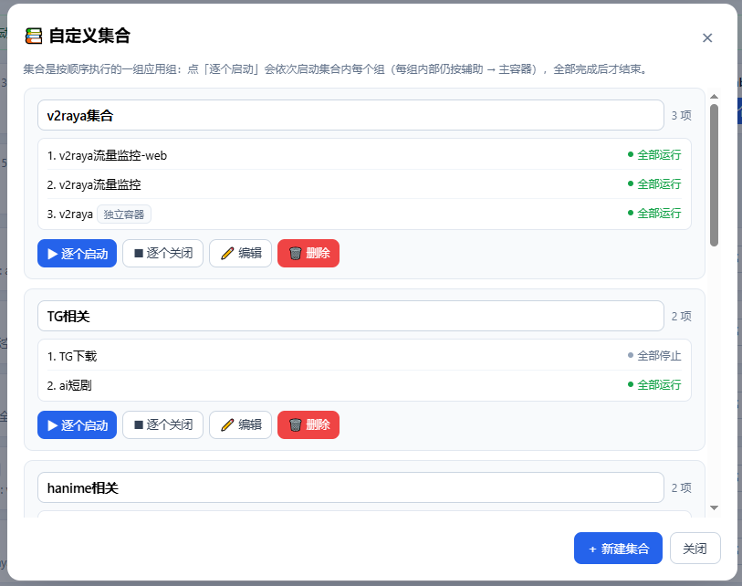
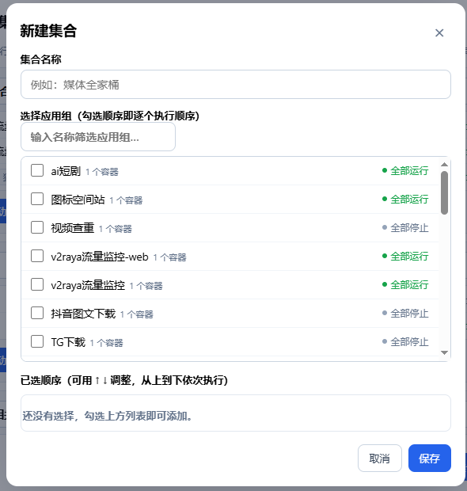

# 【自制工具分享】Docker应用组管理器v1.6.1：主辅容器联动、智能匹配、自定义集合，一键管理NAS Docker应用



先分享一个我自己比较推荐的搭配方式：结合FnDesk的桌面图标生成功能，以及安卓应用「NAS全屏启动器」的桌面快捷方式创建功能使用。可以分别在NAS桌面和安卓手机桌面放一个管理器入口，点击图标就能打开页面，不必每次再去Docker容器列表里寻找需要操作的应用。这只是使用上的搭配建议，不是安装本工具的前提。

这是一款我根据自己使用NAS的需求设计的轻量级Docker管理工具，目前更新到v1.6.1。主要解决两个问题：一个应用包含多个容器时，如何按依赖顺序一起启停；多个不同应用需要一起使用时，如何按自定义顺序统一管理。

## 一、为什么会做这个工具？

NAS上部署的Docker应用越来越多后，我发现很多应用表面上只有一个入口，背后却运行着主程序、数据库、缓存、后台任务等多个容器。如果只是想临时关闭一套服务，或者把相关服务重新启动，就得在容器列表中逐个寻找、逐个操作。

Docker Compose原本可以编排同一个项目中的服务，但我还希望对已经部署好的容器进行分组，甚至把不同Compose项目中的应用组合在一起，形成一个更适合日常使用的集中管理入口。

所以做了这个「Docker应用组管理器」。它不会接管原有的Docker部署，也不需要为了分组去修改已有Compose文件；它在现有容器之上保存应用组与集合的关联配置，通过网页完成启停操作。

## 二、主界面：应用组和独立容器一起管理

进入页面后，可以直接看到Docker的连接状态、容器数量、应用组数量以及自定义集合数量。上方是集合的快捷操作区，下方是应用列表：已经建立关联的容器显示为应用组，尚未分组的容器则作为独立容器显示。



每个应用条目都能执行启动全部、关闭全部、重启等操作。应用组和独立容器统一出现在同一个页面，不需要分别打开不同的管理工具。对于不想建立依赖关系的单容器应用，直接使用即可。

页面还支持按名称实时搜索，以及按照默认顺序、名称A→Z、名称Z→A、运行中优先和已停止优先进行排序。容器多的时候，查找会方便不少。



## 三、应用组：把主容器和辅助容器当成一个应用

这是工具最初的核心功能。假设一个Web应用由主程序、数据库和Redis共同组成，平时启动时往往希望先处理辅助服务，最后再启动主程序；关闭时则反过来。

在管理器中，可以手动创建应用组，填写名称，选择一个主容器，并按需要添加辅助容器。辅助容器的排列顺序就是启动操作的执行顺序。



应用组的执行规则比较明确：

- 启动：辅助容器按设定顺序逐个启动，最后启动主容器。

- 关闭：先关闭主容器，再按相反顺序关闭辅助容器。

- 重启：先按关闭顺序停止整组，再按启动顺序重新启动。

如果不添加辅助容器，这个应用组也可以当作单容器应用使用。已经建立的应用组支持修改名称、更换主容器、增删辅助容器，以及调整辅助容器顺序。

点击应用右侧的展开按钮，还能看到组内实际包含哪些容器、每个容器的当前状态、联动启动和关闭顺序，以及与该组有关的元信息。遇到应用组显示部分运行时，也能展开检查是哪一个成员没有运行。



这里需要说明：管理器控制的是Docker容器启停的先后次序，并不自动等待数据库等服务通过健康检查。如果某个应用需要等待辅助服务完成初始化，可以结合自身部署情况设置组内操作间隔，不能把它理解成完整的服务就绪编排器。

## 四、智能匹配：自动找出可能属于同一应用的容器

如果已经部署了几十个容器，全部手动整理成组仍然比较费时间，因此增加了「智能匹配」。

程序会分析尚未分组的容器，结合Compose项目标记、容器和镜像名称、网络、环境变量中的服务引用、共享挂载路径、容器角色及端口等线索，推荐可能存在关联的主辅容器组合。



扫描结束后，如果发现候选应用组，会显示匹配建议、相关依据及可信度，用户可以先检查、调整，再勾选需要的项目保存。

智能匹配不是强制自动分组。它仅提供候选建议，不会在未确认的情况下直接把所有容器归到一起。对已有应用组的容器，程序会跳过，避免重复归组。对于没有明显关联关系的独立容器，也可能没有候选结果，这是正常情况。

## 五、扫描同步：重建或更新容器后，不必重新整理全部分组

有些Docker应用升级、迁移或者重新部署后，会更换容器名称、增加新服务，甚至移除旧服务。此时管理器原先保存的成员关系可能已经和当前Docker环境不一致。

「扫描同步」会比较已经保存的应用组与目前实际存在的容器，找出需要更新的关联关系。发现差异后，可以在页面中查看变化，勾选需要处理的项目，再执行同步。



扫描不会因为发现旧容器已经不存在就直接删除真实的Docker数据，也不会重建应用容器；同步调整的是管理器保存的分组配置。对于没有变化的应用组，页面会提示当前配置与Docker状态一致。

## 六、自定义集合：多个应用组再次组合，一次操作一整套服务

这是v1.6.0开始新增的重点功能。应用组解决的是“一个应用内部的多个容器如何联动”，而自定义集合解决的是“多个应用如何配合使用”。

例如，我可以分别建立「下载相关」「影音相关」「常用工具」等集合，把多个应用组、尚未归组的独立容器一起放入其中。这样就不必在主界面逐个寻找应用再执行操作。

点击顶部「集合」，可以查看已建立的集合，看到每个集合包含哪些成员，以及成员目前是全部运行还是全部停止。



创建集合时，只要填写一个名称，然后从候选列表中勾选需要加入的应用组或独立容器即可。选择列表支持名称搜索、滚动浏览；选择完成后，还可以通过上下移动调整成员顺序。



集合有两个核心操作：逐个启动和逐个关闭。程序按照集合中排列的顺序，先处理第一个成员，完成后再继续下一个，直至全部处理结束。

如果集合中的某个成员是应用组，该应用组内部仍然按照各自的主辅容器规则执行。如果是独立容器，则直接操作该容器本身。

例如「影音相关」集合可以包含三个应用：媒体整理、媒体服务、辅助工具。点击一次「逐个启动」，这三个应用就会依次执行，不用分别进入每一个应用卡片操作。

集合任务在后台执行，页面会显示执行进度、当前成员和成功或失败结果。某个成员执行失败不会让后面的成员全部停止处理。执行期间对同一个集合再次发起任务，会被拒绝以防止重复操作。

需要特别注意：集合层的关闭操作也是按照集合列表的排列顺序逐项执行，不是自动将整个集合的次序反过来；只有应用组内部的关闭操作才使用与启动相反的主辅顺序。所以，集合成员之间如果存在跨应用依赖，应该根据实际情况安排好顺序。

集合可以改名、调整成员和顺序，也可以删除。删除集合不会删除其中的应用组或Docker容器。

## 七、部署方法：一份Compose就能启动

目前使用单容器部署，前端是原生HTML/CSS/JavaScript，后端采用FastAPI和Docker SDK，管理数据保存到SQLite，不需要另外安装MySQL或Redis。

推荐通过Docker Compose部署。下面是我整理好的配置，镜像版本已经统一为本文介绍的 1.6.1：

```yaml
services:
  docker-group-manager:
    image: jieyousuozhang/docker-group-manager:1.6.1
    container_name: docker-group-manager
    restart: unless-stopped
    ports:
      - "18080:8080"
    volumes:
      - /var/run/docker.sock:/var/run/docker.sock
      - ./data:/data
    environment:
      DATABASE_PATH: /data/app.db
      SELF_CONTAINER_NAME: docker-group-manager
```

将上面的内容保存为 docker-compose.yml，放进单独的项目目录，在该目录中执行：

```bash
docker compose up -d
```

部署成功后，在浏览器访问：

```text
http://你的NAS局域网IP:18080
```

其中 18080 是映射到NAS的端口，可以按自己的端口占用情况修改。./data 是Compose项目目录下的数据文件夹，用于持久化保存SQLite数据库；后续更新镜像或重建容器时不要删除它。SELF_CONTAINER_NAME 用于让管理器识别并排除自身容器，避免在页面中误操作自己。

如果没有现成的镜像部署条件，分享包中也带有Dockerfile和源码，可以自行构建。需要注意源码附带的Compose配置偏向开发调试，长期使用更推荐上面这种固定镜像版本的方式。

## 八、哪些地方需要注意？

这不是完整的Docker运维平台，而是偏向日常启停与分组管理的轻量工具，使用前有几点值得了解。

首先是权限问题。为了读取和管理宿主机容器，它挂载了 /var/run/docker.sock，因此具有较高的Docker操作权限。目前没有内置账号登录和多用户权限控制，建议仅在可信局域网使用，不要直接将18080端口暴露到公网。如果需要远程访问，最好使用VPN，或者配置带认证的反向代理。

其次，管理器操作的是挂载的那一个Docker引擎，并不是多个NAS的集中管理平台。它也不提供容器资源监控、日志中心、定时任务等完整运维功能。

另外，集合的执行顺序属于串行操作，容器和应用越多，整个任务需要的时间越长。任务进度在内存中，管理器进程重启后不会继续显示之前的进度，但保存在SQLite中的应用组与集合配置仍然保留。

删除应用组或集合，只会删除管理器中的配置关系，不会删除对应的真实Docker容器。不过，点击启动、关闭、重启按钮会实际影响服务运行，涉及数据库或其他重要服务时仍应谨慎操作。

## 九、v1.6.1更新了什么？

在之前应用组联动、智能匹配和扫描同步的基础上，最近两个版本主要补充了集合管理能力。

- v1.6.0：加入自定义集合，允许混合选择应用组与独立容器，并按照设定顺序逐个启动、关闭，同时显示后台执行进度。

- v1.6.1：优化集合卡片的自适应网格布局，集合成员选择改为可滚动多选列表，支持按名称筛选；同时修复了部分Docker容器状态读取不到名称时，应用组错误显示为已停止的问题。

## 十、最后

这款工具主要是为了解决我自己在NAS上管理Docker应用时遇到的实际麻烦：应用内部要能联动，多个应用又要能组合，常用操作最好集中在一个页面。

我没有打算让它代替Docker Compose或飞牛自带的Docker管理，而是希望它成为一个更加直观的日常操作入口。

如果你也有一台部署了不少Docker服务的NAS，尤其是有多个容器组成一个应用、需要频繁开启或关闭几套服务的情况，可以试试看。

项目：Docker应用组管理器

版本：v1.6.1

Docker镜像：jieyousuozhang/docker-group-manager:1.6.1

源码包：docker-group-manager-src-1.6.1.zip

有问题或者改进建议，欢迎交流。
